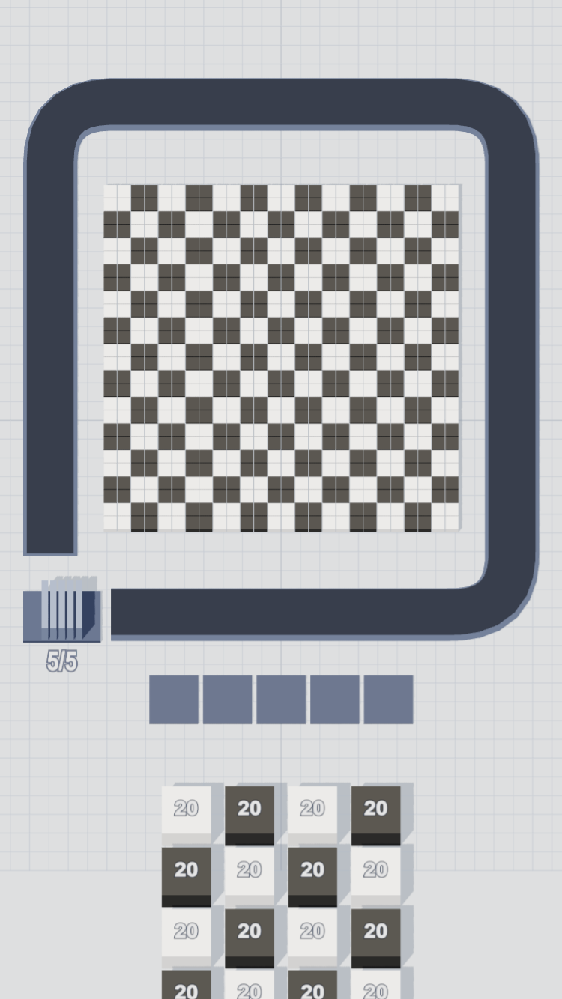
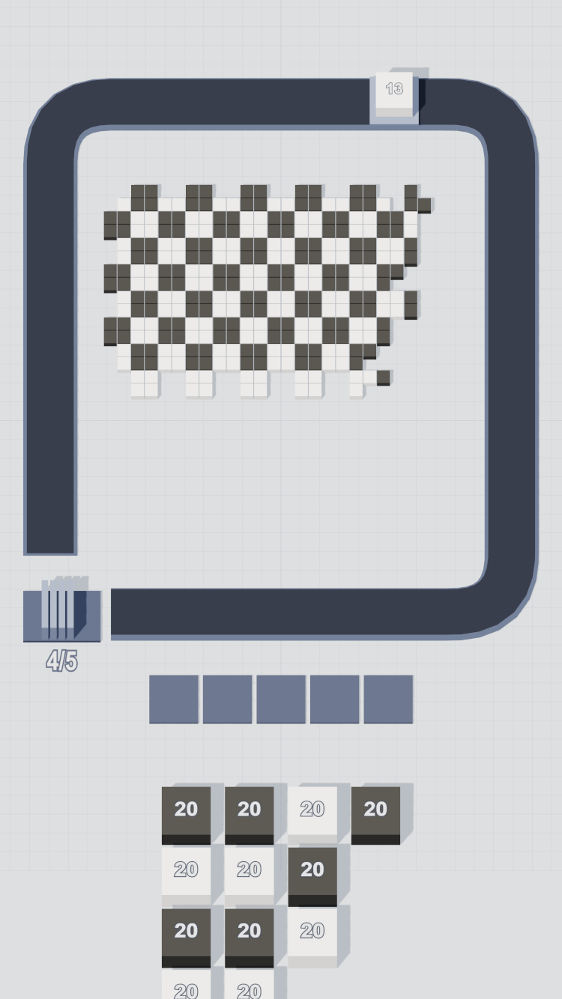
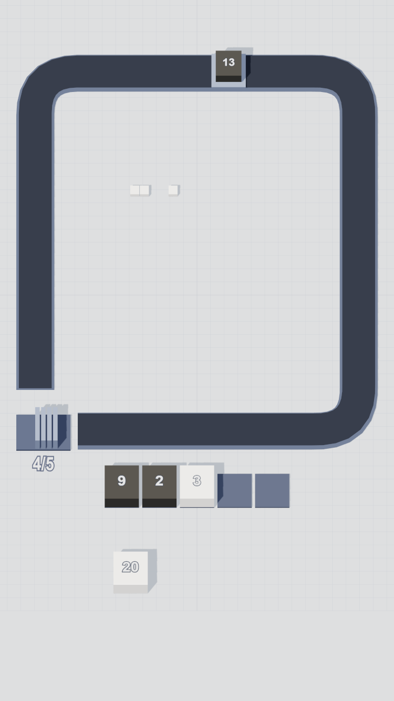
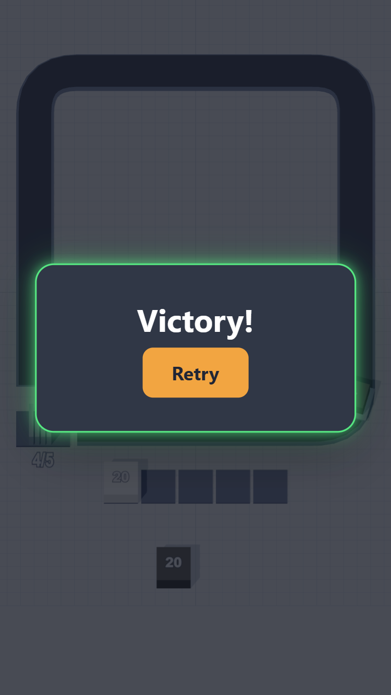
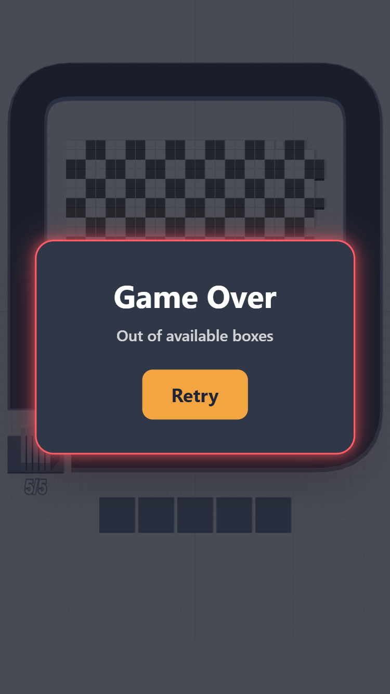

**Lingua:** [Inglese](README.md) | Italiano

# Gioco Puzzle 3D Interattivo - Template Base

Un core modulare e ad alte prestazioni per un gioco puzzle 3D web-based, sviluppato con **Three.js** e **Vite**, caratterizzato da meccaniche di gioco ad abbinamento di colori ispirate a *Pixel Flow*.

> **Versione Reskinnata:** Dai un'occhiata a **[Penguins!](LINK_REPO_PENGUINS)**, la versione finale sviluppata a partire da questo template base.

## Anteprime

<table>
  <tr>
    <td></td>
    <td></td>
    <td></td>
    <td></td>
    <td></td>
  </tr>
</table>

> **Demo Giocabile:** Prova la build direttamente nel browser → **[Gioca a 3D Puzzle Game Core](https://vale007-web.github.io/3d-puzzle-game-core/)**

<br>

## Indice

- [Stack tecnologico e strumenti](#stack-tecnologico-e-strumenti)
- [Avvio rapido (configurazione locale)](#avvio-rapido-configurazione-locale)
- [Versioni evolutive e roadmap di sviluppo](#versioni-evolutive-e-roadmap-di-sviluppo)
- [Regole e condizioni di vittoria/sconfitta](#regole-e-condizioni-di-vittoriasconfitta)
- [Struttura del progetto](#struttura-del-progetto)
- [Metodologia di sviluppo e collaborazione con l'IA](#metodologia-di-sviluppo-e-collaborazione-con-lia)
- [Note legali e diritti d'uso](#note-legali-e-diritti-duso)

<br>

## Stack tecnologico e strumenti

* **Motore / Grafica:** Three.js (WebGL)
* **Bundler e strumento di compilazione:** Vite (ES Modules)
* **Lingua:** JavaScript (ES6+)
* **Architettura:** Logica di gioco modulare (`main.js`, `scene.js`, `config.js`, `grid.js`, `stands.js`, `boxes.js`, `ui.js`)

<br>

## Avvio rapido (configurazione locale)

Per eseguire il progetto in locale, assicurati di avere installato **Node.js (LTS)**, quindi esegui:

1. Installa le dipendenze
`npm install`
2. Avvia il server di sviluppo
`npm run dev`

Apri il browser all'indirizzo del server locale fornito (ad esempio `http://localhost:5173`).

<br>

## Versioni evolutive e roadmap di sviluppo

Questo progetto è stato realizzato seguendo una metodologia iterativa di raffinamento su tre livelli (v1 Core -> v2 Feel -> v3 Polish), per garantire reattività fluida, precisione meccanica e feedback visivo tattile.


### Versione 1: Meccaniche principali (`v1 - primitive`)

**Obiettivo:** Stabilire il ciclo fondamentale del gameplay, il sistema della griglia, il percorso aperto del trasportatore e gli stati di vittoria/sconfitta usando primitive geometriche pure.

* **Cosa è cambiato:**

  * Implementata la griglia principale target 26x26 con schema a scacchiera 2x2 dei colori.
  * Realizzato un percorso aperto del trasportatore a rettangolo arrotondato, con inizio e fine vicino all'angolo inferiore sinistro, il banco inferiore dei contenitori del giocatore e il banco di attesa con 5 posti.
  * Integrata la logica di tiro frontale dei contenitori attivi verso i target corrispondenti della griglia.
  * Aggiunte la condizione principale di vittoria (eliminazione di tutti i target della griglia) e le condizioni di base di sconfitta.
* **Perché ha migliorato la sensazione:** Ha stabilito una struttura visiva chiara e funzionale, coerente con il layout del video di riferimento e con le regole principali del rompicapo.
* **Valori esatti regolati:**

  * Dimensioni della griglia: `26x26` celle.
  * Capacità del banco di attesa: `5 posti`.
  * Velocità base di movimento del trasportatore: `13.2 unità/sec`.


### Versione 2: Reattività e tempistiche (`v2 - feel`)

**Obiettivo:** Migliorare il ridimensionamento dinamico del layout, la gestione degli input, le animazioni fluide di spostamento e l'adattamento della camera.

* **Cosa è cambiato:**

  * **Ridimensionamento dinamico e transizioni:** I contenitori riducono gradualmente la scala al 75% durante il percorso sul trasportatore e tornano gradualmente al 100% quando vengono indirizzati al banco di attesa.
  * **Scorrimento fluido dei contenitori:** Cliccando un contenitore disponibile, questo passa con una transizione interpolata dal banco inferiore al punto di ingresso del trasportatore invece di spostarsi istantaneamente.
  * **Avanzamento per colonna:** Selezionando il contenitore in prima fila, quelli restanti nella stessa colonna avanzano di una posizione.
  * **Contenimento della camera:** Implementato un sistema di inquadratura ortografica con margini laterali dinamici per evitare ritagli sui schermi con rapporto d'aspetto elevato.
* **Perché ha migliorato la sensazione:** Ha eliminato teletrasporti bruschi e spostamenti del layout, rendendo le interazioni naturali, reattive e adattate alle diverse risoluzioni dei dispositivi mobili.
* **Valori esatti regolati:**

  * Rapporto di scala dei contenitori sul trasportatore: `0.75` (riduzione della scala del 25%).
  * Durata dell'animazione dal banco al trasportatore: `350 ms` (easing cubico smoothstep).
  * Frustum della camera ortografica con superiore/inferiore/margini calcolati dinamicamente al ridimensionamento.


### Versione 3: Rifinitura e feedback (`v3 - polish`)

**Obiettivo:** Indicatori visivi, feedback in stato inattivo, feedback migliorato di vittoria/sconfitta e prevenzione intelligente degli blocchi.

* **Cosa è cambiato:**

  * **Indicatori cliccabili (animazione inattiva):** Aggiunta una sottile animazione di oscillazione sincronizzata sull'asse X per i contenitori cliccabili (riga superiore del banco inferiore e elementi del banco di attesa), per guidare l'attenzione del giocatore.
  * **Rotazioni dei supporti:** I supporti ruotano lungo il loro asse orizzontale durante il movimento sul trasportatore.
  * **Feedback migliorato dell'interfaccia:** Integrati popup animati con ingrandimento/dissolvenza in ingresso e bordi luminosi codificati per colore (verde per la vittoria, rosso per la sconfitta).
  * **Motivi descrittivi della sconfitta:** Aggiunto un sottotesto dinamico descrittivo ai popup di Game Over (`Il banco di attesa è pieno`, `Non ci sono altri contenitori disponibili`, `Stallo: nessun target corrispondente raggiungibile`).
  * **Rilevamento intelligente dello stallo cromatico:** Implementati controlli in tempo reale sulla raggiungibilità, affinché, se i contenitori rimasti non possono abbinarsi ad alcun target libero e raggiungibile della griglia, venga evitato il blocco morbido attivando immediatamente il Game Over.
* **Perché ha migliorato la sensazione:** Ha elevato la reattività tattile, la chiarezza visiva e la guida dell'utente, assicurando al contempo che lo stato del rompicapo non si blocchi mai senza un esito chiaro.
* **Valori esatti regolati:**

  * Oscillazione inattiva: velocità angolare `5 rad/sec`, ampiezza `0.055 rad` (attorno all'asse X).
  * Popup dell'interfaccia: dissolvenza dello sfondo di `280 ms`; scala del pannello da `0.8` a `1.0` e opacità da `0` a `1` in `360 ms`, dopo un ritardo di `40 ms`.
  * Configurazione della Shadow Map: `PCFShadowMap` ad alte prestazioni.

<br>

## Regole e condizioni di vittoria/sconfitta

### Stato di vittoria

* **Livello completato:** Attivato immediatamente quando tutti i target di colore sulla griglia centrale 26x26 vengono abbinati ed eliminati.

### Condizioni di Game Over

1. **Banco di attesa pieno:** Si verifica quando un contenitore attivo raggiunge la fine del trasportatore mentre tutti e 5 i posti del banco di attesa sono occupati.
2. **Contenitori esauriti:** Si verifica quando non restano contenitori con munizioni e non ci sono proiettili ancora in movimento, prima di completare la griglia.
3. **Stallo cromatico:** Si verifica quando nessun colore dei contenitori ancora utilizzabili corrisponde a un target esposto, dopo la risoluzione dei colpi e delle eliminazioni in corso.

<br>

## Struttura del progetto
```
.
├── public/             # Favicon pubblica
├── screenshot/         # Screenshot del gioco
├── index.html          # Punto di ingresso HTML e mount point dell'applicazione
├── package.json        # Dipendenze e script
├── vite.config.js      # Configurazione della compilazione Vite
└── src/
   ├── main.js         # Configurazione dell'app e ciclo di animazione/rendering
   ├── config.js       # Valori di layout, colori e bilanciamento del gioco
   ├── scene.js        # Scena Three.js, camera, illuminazione e viewport responsive
   ├── grid.js         # Creazione dei cubi target
   ├── stands.js       # Supporti e relativo movimento
   ├── boxes.js        # Contenitori, proiettili e abbinamento dei colori
   ├── ui.js           # Sprite di munizioni/testo e finestra di vittoria/sconfitta
   └── style.css       # Layout della pagina e animazioni della finestra
```

<br>

## Metodologia di sviluppo e collaborazione con l'IA

Questo progetto è stato sviluppato utilizzando un flusso di lavoro collaborativo unico e altamente ottimizzato con due IA, che combina **Gemini** e **GitHub Copilot**:

1. **Gemini (Strategia e protezioni):** Utilizzato come collaboratore per l'architettura e l'ingegneria dei prompt. Le richieste di modifica grezze venivano fornite a Gemini, che le trasformava in prompt tecnici precisi e altamente strutturati, corredati da vincoli rigorosi e protezioni delle prestazioni.
2. **GitHub Copilot (Implementazione):** I prompt ottimizzati generati da Gemini venivano quindi forniti direttamente a Copilot in VS Code, che aveva il pieno contesto del progetto ed eseguiva le inserzioni di codice e le modifiche ai file con precisione. Questo ha massimizzato l'efficienza dei token e ridotto al minimo i cicli di iterazione.
3. **Rifinitura manuale del codice e messa a punto:** L'autore ha mantenuto una supervisione pratica durante tutto il processo, effettuando modifiche dirette manualmente, debug, correzioni della logica, regolazioni dei parametri e messa a punto per garantire precisione assoluta e rifinitura visiva.
4. **Filtraggio del registro dei prompt:** I registri ufficiali dei prompt si concentrano sulle principali tappe architetturali e sulle funzionalità fondamentali. Le modifiche iterative banali (come piccole regolazioni delle coordinate o modifiche esplorative dei parametri effettuate manualmente) sono state omesse per maggiore chiarezza.

<br>

## Note legali e diritti d'uso

**© 2026 Valerio Galfano. Tutti i diritti riservati.**

Questo progetto — inclusi il codice sorgente e l'architettura software presenti in questa repository — è di proprietà intellettuale esclusiva dell'autore, ad eccezione delle librerie di terze parti soggette alle rispettive licenze. Il gameplay si ispira a *Pixel Flow*.

- **Scopo:** Questo progetto è stato sviluppato come pezzo per il portfolio personale con l'obiettivo di mostrare competenze di technical art, sviluppo web 3D e logica di gioco interattiva a potenziali clienti, recruiter e figure di valutazione.
- **Restrizioni:** È severamente vietato l'uso non autorizzato, la copia, la ridistribuzione, la modifica, l'esposizione pubblica o lo sfruttamento commerciale di qualsiasi parte del codice sorgente o dell'architettura di questo repository senza previa autorizzazione scritta esplicita da parte dell'autore.