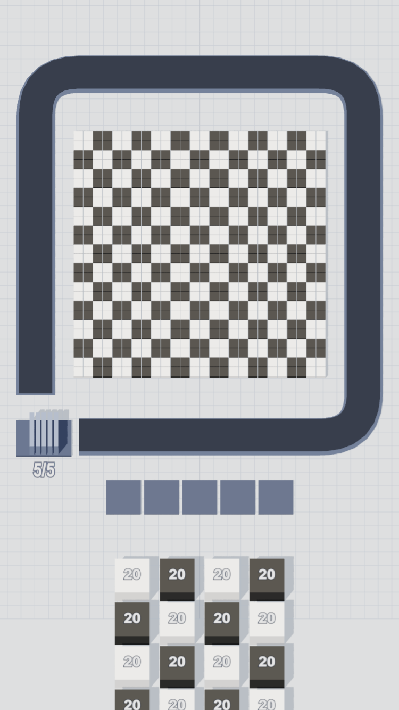
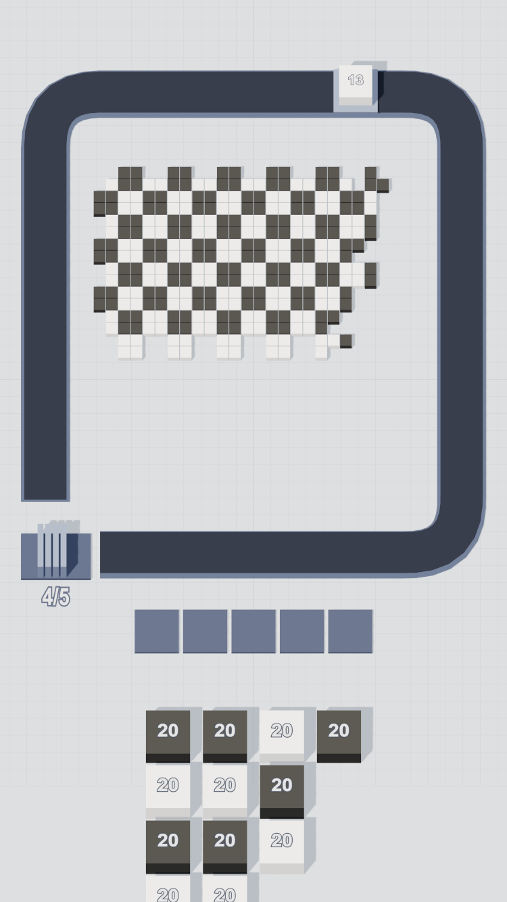
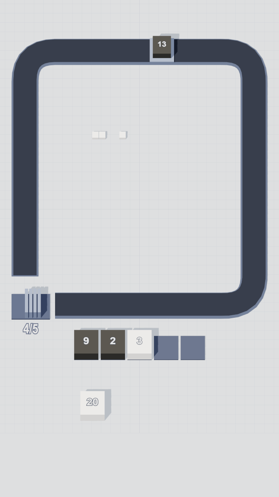
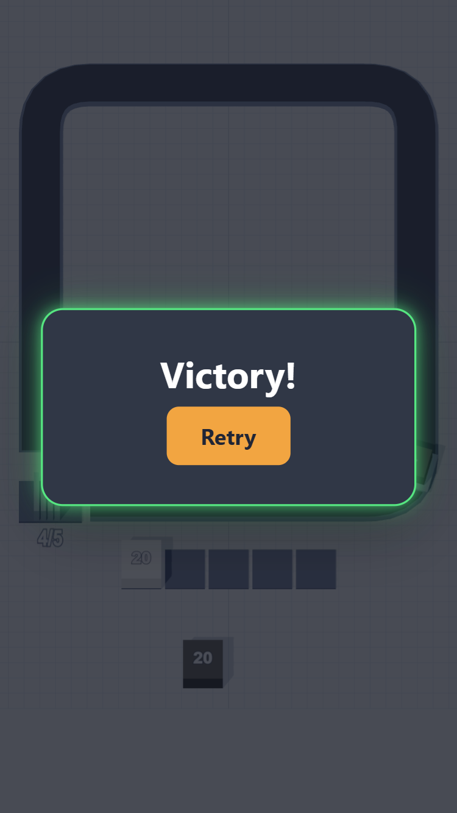
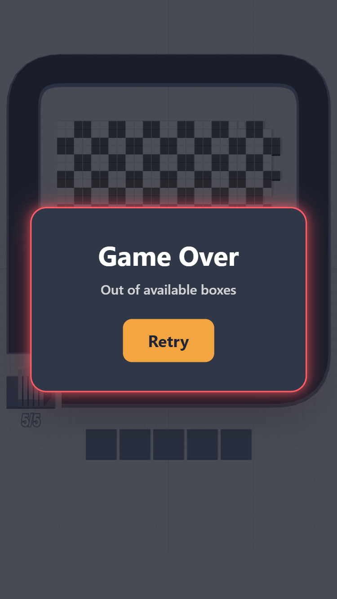

**Lingua:** [Italiano](README.it.md) | English

# Interactive 3D Puzzle Game - Base Template

A high-performance, modular 3D web-based puzzle game core built with **Three.js** and **Vite**, featuring color-matching gameplay mechanics inspired by *Pixel Flow*.

> **Reskinned Version:** Check out **[Penguins!](LINK_REPO_PENGUINS)**, the final reskinned edition built on top of this base template.

## Previews

<table>
  <tr>
    <td></td>
    <td></td>
    <td></td>
    <td></td>
    <td></td>
  </tr>
</table>

> **Playable Demo:** Try the live build in your browser → **[Play 3D Puzzle Game Core](https://vale007-web.github.io/3d-puzzle-game-core/)**

<br>

## Contents

- [Tech Stack & Tools](#tech-stack--tools)
- [Quick Start (Local Setup)](#quick-start-local-setup)
- [Evolutionary Versions & Development Roadmap](#evolutionary-versions--development-roadmap)
- [Rules & Win/Loss Conditions](#rules--winloss-conditions)
- [Project Structure](#project-structure)
- [Development Methodology & AI Collaboration](#development-methodology--ai-collaboration)
- [Project Disclaimer & Usage Rights](#project-disclaimer--usage-rights)

<br>

## Tech Stack \& Tools

* **Engine / Graphics:** Three.js (WebGL)
* **Bundler \& Build Tool:** Vite (ES Modules)
* **Language:** JavaScript (ES6+)
* **Architecture:** Modular game logic (`main.js`, `scene.js`, `config.js`, `grid.js`, `stands.js`, `boxes.js`, `ui.js`)

<br>

## Quick Start (Local Setup)

To run the project locally, ensure you have **Node.js (LTS)** installed, then execute:

1. Install dependencies
`npm install`
2. Run the development server
`npm run dev`

Open your browser at the provided local server URL (e.g., `http://localhost:5173`).

<br>

## Evolutionary Versions \& Development Roadmap

This project was built following a three-tier iterative refinement methodology (v1 Core -> v2 Feel -> v3 Polish) to ensure fluid responsiveness, mechanical accuracy, and tactile visual feedback.


### Version 1: Core Mechanics (`v1 - primitive`)

**Focus:** Establishing the foundational gameplay loop, grid system, open conveyor path, and win/loss states using pure geometric primitives.

* **What Changed:**

  * Implemented the main 26x26 target grid with a 2x2 color checker pattern.
  * Built an open rounded-rectangle conveyor path with its start and end near the lower-left corner, the lower player box bench, and the 5-slot waiting bench.
  * Integrated forward-only projectile targeting from active boxes to matching grid targets.
  * Added primary Win condition (clearing all grid targets) and basic Loss conditions.
* **Why It Improved Feel:** Established a clear, functional visual structure matching the reference video layout and core puzzle rules.
* **Exact Values Tuned:**

  * Grid dimensions: `26x26` cells.
  * Waiting bench capacity: `5 slots`.
  * Base conveyor movement speed: `13.2 units/sec`.


### Version 2: Responsiveness \& Timing (`v2 - feel`)

**Focus:** Enhancing dynamic layout scaling, input handling, fluid transit animations, and camera adaptation.

* **What Changed:**

  * **Dynamic Scaling \& Transitions:** Boxes smoothly scale down to 75% when travelling along the conveyor belt and smoothly scale back to 100% when routed into the waiting bench.
  * **Fluid Box Gliding:** Clicking an available box transitions it via smooth interpolation directly from the bottom bench to the belt entry point rather than instantly warping it.
  * **Column Progression:** Selecting a front-row box advances the remaining boxes in its column by one position.
  * **Camera Containment:** Implemented an orthographic framing system with dynamic side margins to prevent cropping on high-aspect-ratio screens.
* **Why It Improved Feel:** Removed jarring teleports and layout shifts, making interactions feel natural, responsive, and tailored for various mobile device resolutions.
* **Exact Values Tuned:**

  * Belt Box Scale Ratio: `0.75` (25% scale reduction).
  * Bench-to-Belt Glide Animation Duration: `350 ms` (cubic smoothstep easing).
  * Orthographic Camera Frustum Top/Bottom/Margins dynamically calculated on resize.


### Version 3: Polish \& Juice (`v3 - polish`)

**Focus:** Visual cues, idle feedback, refined win/loss feedback, and smart deadlock prevention.

* **What Changed:**

  * **Clickable Cues (Idle Anim):** Added a subtle, synchronized X-axis rocking animation for clickable boxes (top row of bottom bench \& waiting bench items) to guide player focus.
  * **Stand Rotations:** Stand supports rotate along their horizontal axis when moving along the belt.
  * **Enhanced UI Feedback:** Integrated animated scale-up/fade-in popups featuring color-coded glowing borders (Green for Victory, Red for Defeat).
  * **Descriptive Defeat Reasons:** Added descriptive dynamic subtext for Game Over popups (`Waiting bench is full`, `Out of available boxes`, `Deadlock: No matching targets reachable`).
  * **Smart Color Deadlock Detection:** Implemented real-time reachability checks ensuring that if remaining boxes cannot match any unobstructed, reachable grid targets, a soft-lock is avoided by immediately triggering Game Over.
* **Why It Improved Feel:** Elevated tactile responsiveness, visual clarity, and user guidance while ensuring the puzzle state never freezes without a clear outcome.
* **Exact Values Tuned:**

  * Idle Rocking: angular speed `5 rad/sec`, amplitude `0.055 rad` (around X-axis).
  * UI Popup: backdrop fade `280 ms`; panel scale `0.8` -> `1.0` and opacity `0` -> `1` over `360 ms`, after a `40 ms` delay.
  * Shadow map configuration: High-performance `PCFShadowMap`.

<br>

## Rules \& Win/Loss Conditions

### Victory State

* **Level Cleared:** Triggered immediately when all color targets on the central 26x26 grid are matched and cleared.

### Game Over Conditions

1. **Waiting Bench Full:** Occurs when an active box reaches the end of the conveyor while all 5 waiting-bench slots are occupied.
2. **Out of Boxes:** Triggered when no player boxes with ammo remain and no projectiles are still resolving before the grid is cleared.
3. **Color Deadlock:** Triggered when no remaining playable box color matches an exposed target after pending shots and target destruction have resolved.

<br>

## Project Structure
```
.
├── public/             # Public favicon
├── screenshot/         # Gameplay screenshots
├── index.html          # HTML entry point and application mount point
├── package.json        # Dependencies \& scripts
├── vite.config.js      # Vite build configuration
└── src/
   ├── main.js         # Application setup and animation/render loop
   ├── config.js       # Layout, color, and gameplay tuning values
   ├── scene.js        # Three.js scene, camera, lighting, and responsive viewport
   ├── grid.js         # Target cube creation
   ├── stands.js       # Support stands and their movement
   ├── boxes.js        # Player boxes, projectiles, and color matching
   ├── ui.js           # Ammo/text sprites and win/loss modal with subtitles
   └── style.css       # Page layout and modal animations
```

<br>

## Development Methodology \& AI Collaboration

This project was engineered using a unique, highly optimized **Dual-AI Collaborative Workflow** combining **Gemini** and **GitHub Copilot**:

1. **Gemini (Strategy \& Guardrails):** Used as an architectural and prompt-engineering collaborator. Raw change requests were fed to Gemini, which translated them into precise, highly structured technical prompts equipped with strict constraints and performance guardrails.
2. **GitHub Copilot (Implementation):** The optimized prompts generated by Gemini were then fed directly to Copilot in VS Code, which had full project context and executed the precise code insertions and file modifications. This maximized token efficiency and minimized iteration cycles.
3. **Manual Code Refinement \& Fine-Tuning:** The author maintained hands-on oversight throughout the process, performing direct manual code edits, debugging, logic corrections, parameter adjustments, and fine-tuning to ensure absolute precision and visual polish.
4. **Prompt Log Filtering:** Official prompt records focus on core architectural milestones and functional features. Trivial, iterative adjustments (such as minor coordinate tweaking or exploratory parameter adjustments done manually) have been omitted for clarity.

<br>

## Project Disclaimer & Usage Rights

**© 2026 Valerio Galfano. All Rights Reserved.**

This project — including its source code and software architecture contained within this repository — is the exclusive intellectual property of the author, excluding third-party libraries under their respective licenses. The gameplay is inspired by *Pixel Flow*.

- **Purpose:** This project was developed as a personal portfolio piece to showcase technical art, 3D web development, and interactive game logic for potential clients, recruiters, and evaluation stakeholders.
- **Restrictions:** Unauthorized use, copying, redistribution, modification, public display, or commercial exploitation of any part of this repository's source code or architecture without explicit prior written authorization from the author is strictly prohibited.